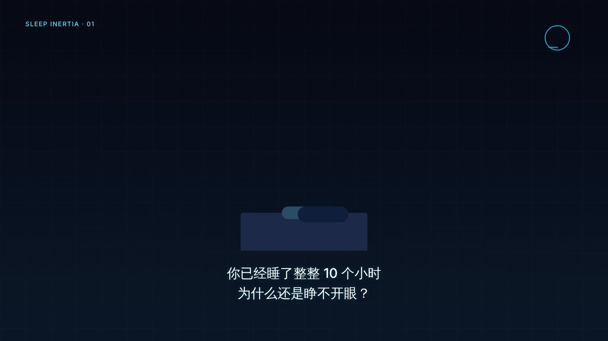
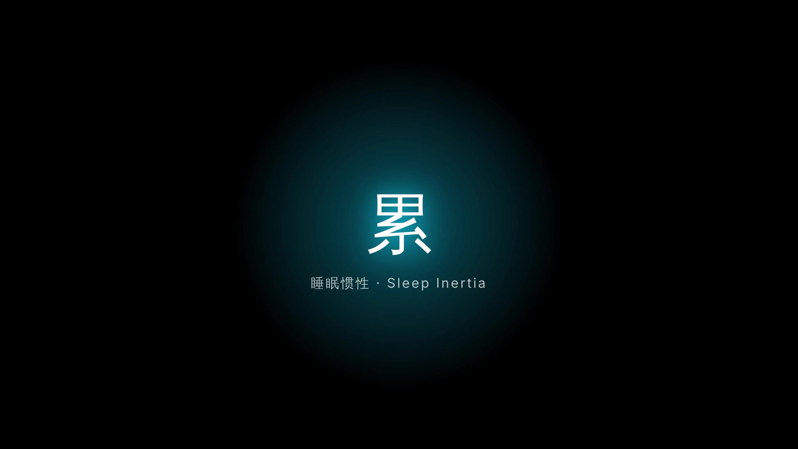

# HyperFrames Vibe 视频大赏（16:9 横版）· 豆包工作第三方技能

> **第三方技能声明**：本项目为**非官方**的第三方自定义技能，与 HeyGen 及其官方产品无任何隶属、背书或合作关系。
> 技能所驱动的上游框架 **HyperFrames** 由 **HeyGen** 开源（Apache-2.0），仓库地址：https://github.com/heygen-com/hyperframes
> 本仓库仅包含重新编写的提示词/技能文档与示例代码，未复制上游任何源码或官方技能原文。

基于 [HyperFrames](https://github.com/heygen-com/hyperframes) 框架，为**豆包工作「本地电脑」模式**量身定制：一句主题 → 自动生成完整分镜脚本 → 写入 1920×1080 高清视频工程（HTML + GSAP 时间线）→ lint 校验 → preview 预览 → render 导出 MP4。

## 效果预览

两个完整示例工程的画面截图（1920×1080 实拍渲染帧）：

**熵增科普 · 分点拆解式**


**越睡越累 · 锚词高潮模板**



## 特性

- ✅ **专业写作体系**：钩子类型自动匹配 + 主体逻辑自动选择 + 结尾方式自动收口，不是套模板
- ✅ **锚词高潮模板**：17 秒重拍爆发点，情绪节奏精确到帧
- ✅ **炫酷视觉风格**：风格自适应（赛博 / 治愈 / 国潮 / 极简 / 玻璃拟态 / 粒子星云），不做统一克制感
- ✅ **元素贯穿转场**：形状变形 / 线条延伸 / 细节推近 / 色彩过渡，拒绝硬切
- ✅ **完整排版规范**：字号 / 字重 / 位置 / 颜色全部标准化，中文清晰可读
- ✅ **1920×1080 高清输出**：默认 1080p 横版，开箱即测
- ✅ **模块化子组合架构**：每个场景独立 HTML 文件，跨文件挂载
- ✅ **附完整可渲染示例**（40 秒熵增科普），0 错误 0 警告

## 目录结构

```
hyperframes-vibe-169/
├── SKILL.md                          # 技能主体（豆包工作自定义技能）
├── references/
│   ├── hyperframes-contract.md       # HyperFrames 组合契约精编（写码前通读）
│   └── documentary-director.md       # 纪录片导演规范（可选风格：锚词/音乐对位/无口播时触发）
├── examples/
│   ├── entropy-16-9/                 # 40秒 1920×1080 熵增科普（分点拆解式基础模板）
│   │   ├── index.html                #   宿主：挂载 5 个分镜子组合
│   │   └── compositions/             #   5 个场景子组合文件
│   └── sleep-tired-16-9/            # 40秒 1920×1080 越睡越累（锚词驱动高潮模板）
│       ├── index.html                #   宿主：挂载 4 个场景子组合
│       └── compositions/             #   4 个场景子组合文件（钩子/高潮/解释/结尾）
├── LICENSE                           # Apache-2.0
└── 豆包技能包-hyperframes-vibe-169.zip  # 已打包，可直接上传豆包技能库
```

## 安装（豆包工作｜本地电脑模式）

### 1. 本机环境（豆包不代装，一次性装好即可）

环境只需装一次，之后所有项目共用。按你的系统选一条命令复制粘贴即可。

**① 安装 Node.js（≥ 22）**

Windows（任选其一）：
```powershell
winget install OpenJS.NodeJS.LTS
```
或去 [nodejs.org](https://nodejs.org) 下载 **LTS 版**安装包，一路「下一步」装完。

macOS：
```bash
brew install node@22 && brew link --overwrite node@22
```

验证（应显示 v22.x.x 或更高）：
```bash
node -v
```

**② 安装 FFmpeg**

Windows：
```powershell
winget install Gyan.FFmpeg
```

macOS：
```bash
brew install ffmpeg
```

验证：
```bash
ffmpeg -version
```

**③ 一键自检（全绿即可继续）**

复制下面整行到终端运行，出现 3 行版本/诊断信息且无报错即环境就绪：
```bash
node -v && ffmpeg -version | head -1 && npx -y hyperframes@latest doctor
```

**④ 初始化 HyperFrames 项目（每个项目执行一次）**
```bash
npx hyperframes init <项目名> && cd <项目名>
```

### 2. 导入技能（二选一）
- **方式 A（上传 zip）**：豆包 PC 客户端 → 「插件·技能·伙伴」→「技能」→「+ 添加」→「上传技能」→ 选择 `豆包技能包-hyperframes-vibe-169.zip`
- **方式 B（对话新建）**：打开「与豆包对话新建技能」，粘贴 `SKILL.md` 全文，保存

### 3. 新建工作任务
1. 「新工作任务」→ 工作设备选 **本地电脑**
2. 授权你的 HyperFrames 项目文件夹
3. 启用技能 `hyperframes-vibe-169`

### 4. 下达任务示例
```
使用 hyperframes-vibe-169 技能，做一个 40 秒的熵增科普视频。
```

豆包会自动：
1. 读取项目目录下的 `index.html`
2. **先生成分镜脚本给你确认**（钩子类型 / 主体逻辑 / 结尾方式 / 时间戳 + 画面 + 字幕）
3. 你确认后，写入完整 HyperFrames 组合代码
4. 执行 `npx hyperframes lint` 并修复报错
5. 启动 `npx hyperframes preview` 本地预览
6. 你满意后下达 `npx hyperframes render` 导出 MP4

## 快速测试示例（不装技能也能跑）

```bash
npx hyperframes init vibe-demo && cd vibe-demo
cp -r /path/to/examples/entropy-16-9/* .   # 覆盖 index.html，并带入 compositions/ 子组合
npx hyperframes lint      # 0 errors, 0 warnings
npx hyperframes preview   # 浏览器预览动画
npx hyperframes render    # 导出 1920×1080 MP4
```

## 写作体系速览

收到主题后，技能会自动选择最合适的结构组合：

| 维度 | 自动匹配选项 |
|------|-------------|
| **钩子类型** | 反常识结论型 / 灵魂提问型 / 现象悬念型 / 数字冲击型 |
| **主体逻辑** | 分点拆解式 / 递进推理式 / 实验验证式 / 辟谣纠偏式 |
| **结尾方式** | 总结强化型 / 互动引导型 / 留钩关注型 / 价值延伸型 |
| **时长档位** | 15-30秒超短 / 1-3分钟中长 / 3-5分钟长科普 |
| **赛道变体** | 冷知识 / 科学实验 / 生活健康 / 人文历史 |

要求强节奏、重拍对位、纪录片风格时，自动切换「锚词驱动的经典高潮模板」——第 17 秒重拍爆发，精确到帧。

## 注意事项

- 示例代码使用通用字族（`system-ui, sans-serif`）规避 lint；如需更优中文渲染，请将本地字体放入项目并配置 `@font-face`。
- 旁白与 BGM 请在 `assets/` 放入音频文件后，取消示例中注释掉的 `<audio>` 标签（每个 audio 必须有 `id` 和 `src`）。
- 本技能面向豆包工作「本地电脑」模式；不支持 Claude Code 的 `/hyperframes` 斜杠命令体系。

## License

本仓库内容（技能文档、示例代码）采用 [Apache-2.0](LICENSE)。上游 HyperFrames 由 HeyGen 以 Apache-2.0 协议开源，使用本技能即视为同时遵守上游协议要求（保留版权声明、注明来源）。如需商用，请自行核对 HeyGen 上游许可与商标使用规则。
